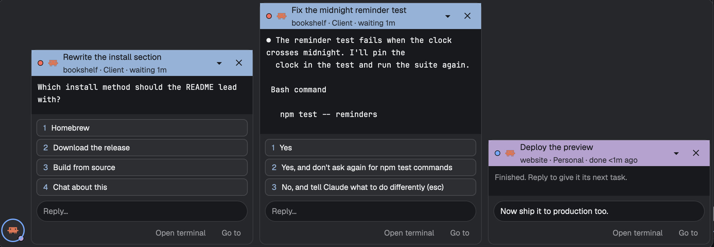

# Chat bar for Herdr

A chat bar in the bottom-right corner of every layout, one bubble per agent that is waiting on you. Read the
agent's question, press one of its options or type a reply, and keep working where you are.



## Use cases

- **An agent asks for permission while you work in another tab.** Its bubble opens with the command and the
  options Yes / Yes, don't ask again / No. Press 1 and it carries on. You never left your tab.
- **Three agents ask questions at once.** Each gets its own bubble, oldest first, up to three open side by
  side. The rest wait as round heads next to them.
- **An agent finished.** It shows up as a head. Click it, type its next task, press Enter.
- **The question needs more context.** "Open terminal" shows the agent's live terminal in a window over your
  layout. "Go to" takes you to its pane.
- **You see the agent anyway.** Agents in the tab on screen get no bubble; you can answer them right there.

## Features

- A bubble per agent that needs you, a round head per agent that finished. The newest status wins; a bubble
  you close stays closed until its agent's status changes.
- Reads the agent's screen (`hc read`) and turns Claude Code's prompts into a question and buttons: permission
  prompts, multiple-choice questions with descriptions, older boxed prompts. Other agents show the last lines
  of their screen.
- Replies go to that agent's terminal by address (`hc send`, `hc keys`), never to the focused one.
- Headers show the title, space, how long it has waited and, with a plug-in, a context tag and color.
- Minimize a bubble to its header, close it, open the terminal, go to the pane.
- Floats over any layout and hides when nobody waits. Drag it to another corner if you like.
- Other mods can open a bubble with a drafted reply, add titles and context labels, and switch context before
  "Go to". The contract is in [PROVIDERS.md](mods/chatbar/PROVIDERS.md).

## Works with

The chat bar, [Go to](https://github.com/saefty/herdr-goto) and [PR review](https://github.com/saefty/herdr-pr-review)
each work alone. Installed together, they plug into each other:

- With **Go to** (⌘⇧P), agents waiting on you show up as "Reply to …" and open their bubble here. Go to is
  extensible: the chat bar uses its [provider contract](https://github.com/saefty/herdr-goto/blob/main/mods/goto/PROVIDERS.md).
  A context mod that registers Go to's context hook also tags the bubbles and switches context on "Go to".
- With **PR review**, Discuss on a finding opens the agent's bubble here with the finding drafted in the reply
  field (`chatbar.request`).
- Your own mod can open a bubble the same way, or add titles and context labels per agent. See
  [PROVIDERS.md](mods/chatbar/PROVIDERS.md).

## Install

1. Copy `mods/chatbar` to `~/.config/herdr-app/mods/`.
2. Add the floating block to each layout you want it in (`~/.config/herdr-app/layouts/<name>.json`), on the
   root node or the node that holds your terminals:

   ```json
   "floating": [
     { "id": "chatbar", "content": { "mod": "chatbar" }, "edge": "bottom", "align": "end" }
   ]
   ```

   If the node already has a `floating` list, add the entry to it.
3. Run `herdr-app check ~/.config/herdr-app/mods/chatbar`.

It runs `hc read`, `hc send` and `hc keys` on your agents' terminals, nothing else. It makes no network calls and
reads no files.

## Tests

`node --test mods/chatbar/test_screen.mjs mods/chatbar/test_plugins.mjs`

## License

MIT
