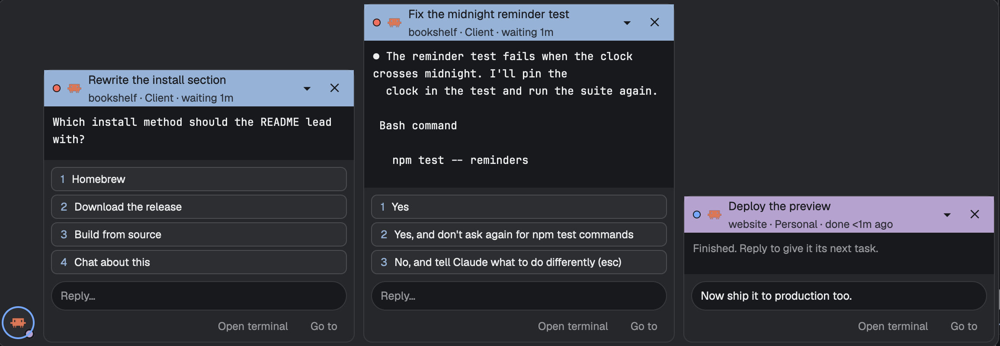

# Chat bar

A chat bar that floats in the bottom-right corner of every layout, like a messenger's chat tabs. Each agent that
needs you gets a bubble with its question, the answer options as buttons and a reply field. Finished agents wait
as round heads. You answer without leaving the tab you are in.

**What you see:** a floating block at the bottom right, drawn by Herdr's float frame, holding one horizontal
row, aligned to the bottom, 10 px gaps, 4 px side padding:

- **Heads** (left of the bubbles, 6 px apart): 38 px circles in the `raised` color with a 2 px ring in the
  status color (`blocked` red for needs you, `done` for finished). Inside, the program icon at 18 px (tinted
  with `foreground` when the icon is a glyph), else the title's first letter at 14 px semibold. A 12 px dot at
  the bottom right in the context color, with a 2 px `background` ring. Hover: `hover` background. Tooltip:
  "title · space · context label · needs you / finished".
- **Bubbles** (right to left, the first one at the corner): 360 px wide, 10 px corners, 1 px `border`, `popover`
  background.
  - Header, 42 px, 10 px padding, background the context color (else `accent`), text in `background`: a 9 px
    status dot, the 16 px program icon, the title (13.5 px semibold, truncated) over a line "space · context
    label · waiting 5m" (12.5 px, 85% opacity; "done 3m ago" when finished). On the right two 24 px buttons:
    ▾/▴ (minimize/open) and ✕ (close until the status changes).
  - The screen: 12.5 px in the person's terminal font (`settings().font_family`), `background` color, 10 px
    by 8 px padding, up to 12 lines, scrolls when wrapped lines need more. While reading: "Reading the screen…"
    in `muted`. Finished: "Finished. Reply to give it its next task."
  - Options: one 28 px row per choice, 7 px corners, 1 px `input` border, `raised` background: the number in the
    context color (semibold), the label truncated. Hover: `hover` background and a context-colored border.
  - After a send, "Sent option 1" or "Sent “text”" in `muted`.
  - A 34 px reply field, fully rounded (17 px), `input` border, `background` fill, placeholder "Reply…".
  - A 36 px action row, right aligned: "Open terminal" and "Go to" as 26 px text buttons in `muted`.
- Bubbles and heads of an agent hidden by the current context are dimmed (bubble 50%, head 45%).

**How it behaves:**
- `blocked` (needs you): a bubble opens by itself, the oldest first, at most 3 open. More wait as heads.
  `done`: a head. `working` and `idle` agents show only when another mod asked for them (below). An agent in
  any pane of the tab on screen, or the focused terminal, gets nothing: you can see it.
- New bubbles mount folded and grow one frame later: the body's height and opacity animate (180 ms ease-out).
  Minimize animates back to the header.
- A blocked bubble reads its agent's screen once per status change or open (`hc read <address> --json`) and
  parses it: the last block of numbered lines starting at 1 becomes buttons (a `❯`/`›`/`>` marker, rules and
  indented description lines inside the block are allowed), the lines above it the question. Without
  options: the last lines above Claude Code's input box (the second-to-last rule near the bottom).
- An option button sends that key (`hc keys <address> <n>`). Enter in the reply field sends the text
  (`hc send --force -- <address> <text>` when blocked, without `--force` otherwise). An error shows as a toast.
- Clicking a head opens its bubble in front. ✕ closes until the agent's status changes; closed boxes are shared
  so every layout agrees.
- "Open terminal" opens a 780 × 480 window with the shipped `peek` mod as a 30 px title bar over the live
  terminal. "Go to" focuses the pane, through the context hook when one listens in this layout.
- The wait labels refresh every 30 s. With nobody waiting the mod renders an empty `div`, so the float hides.
- Plug-ins (PROVIDERS.md): `chatbar.request` opens a bubble (`draft` fills the reply field without sending),
  `chatbar.agents.<provider>` adds title, context, label, color, hidden; `goto.context` gives contexts, labels,
  colors, the current context and the "Go to" route; with Go to installed, waiting agents become "Reply to …".

**Built from:** a mod `mods/chatbar` with `mod.json` `{ "place": "none" }`, placed by each layout's `floating`
list: `{ "id": "chatbar", "content": { "mod": "chatbar" }, "edge": "bottom", "align": "end" }`.
`main.js` (the view), `screen.js` (pure: screen text to `{lines, options}`), `plugins.js` (pure: provider merge,
agent info, the "Go to" route, request parsing, Go to items). It uses `agents() spaces() panes() focused()
theme() settings() shared() setShared() run() hc() openOverlay() notify()`, gpui-base's `InputState`/`Input`,
and the commands `pane.focus` plus `hc read`, `hc send`, `hc keys`. One `InputState` per open slot is made in
`init` (it can't be made in render); each slot belongs to an address and is cleared when it changes hands.

**Watch out:**
- `InputState.new` only works in `init`: keep 3 inputs and hand them to bubbles by slot.
- Never send to the focused terminal: always by address. A blocked Claude Code refuses plain sends; `--force`
  types into its dialog.
- Set shared state outside render (`cx.timer.after(0, …)`) and only when the value changed: every set
  re-renders every mod.
- Take a request, then set `chatbar.request` back to `null`; deduplicating by `at` breaks Go to's items,
  whose value is fixed.
- A screen read takes about 0.4 s; read only open blocked bubbles, once per status change, and drop a result
  whose status moved on meanwhile.
- The height transition needs an explicit body height: compute it from the line and option counts.
- Herdr's `done` turns `idle` once someone looks at the agent, so a head disappears when you visit it.

**Done when:** `herdr-app check mods/chatbar` passes; `node --test mods/chatbar/test_screen.mjs
mods/chatbar/test_plugins.mjs` passes; with a Claude Code agent asking permission in another tab, its bubble
appears bottom right with the question and the options as buttons, pressing 1 answers it and the bubble goes
away when the agent works again; a finished agent shows as a head; and
`setShared("chatbar.request", {action: "draft", terminal, text})` from another mod opens that agent's bubble with
the text in its reply field.
